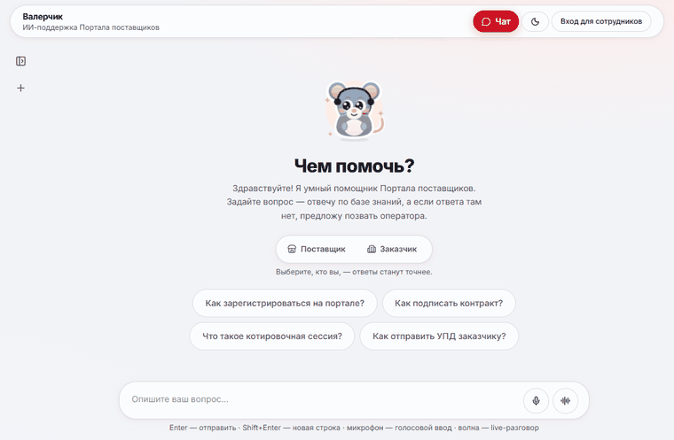
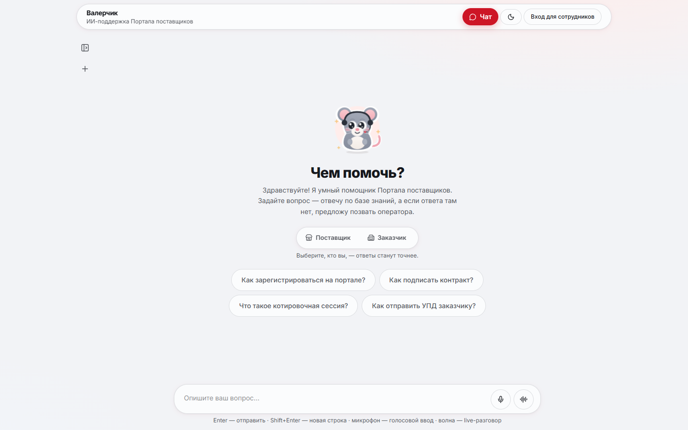
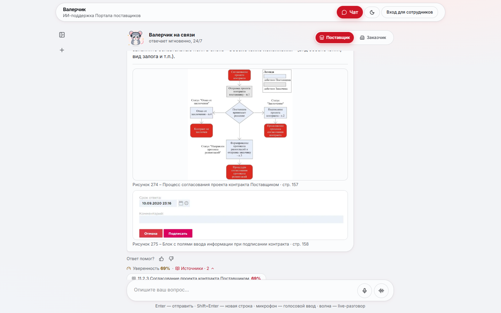
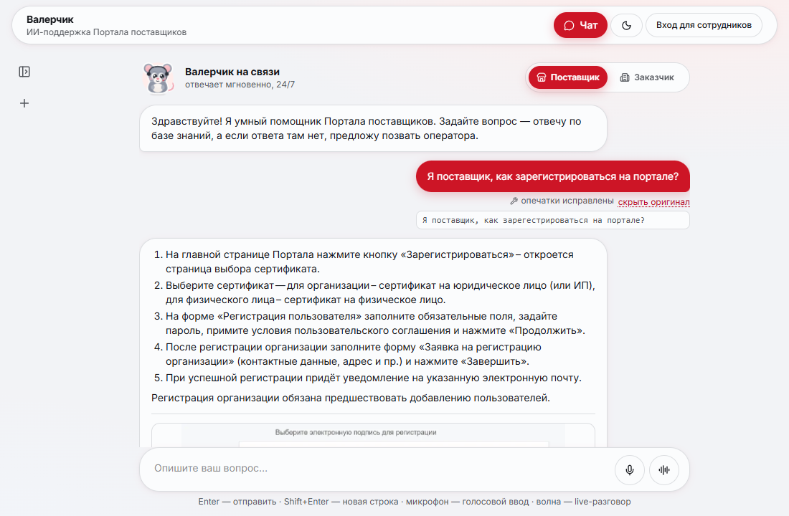
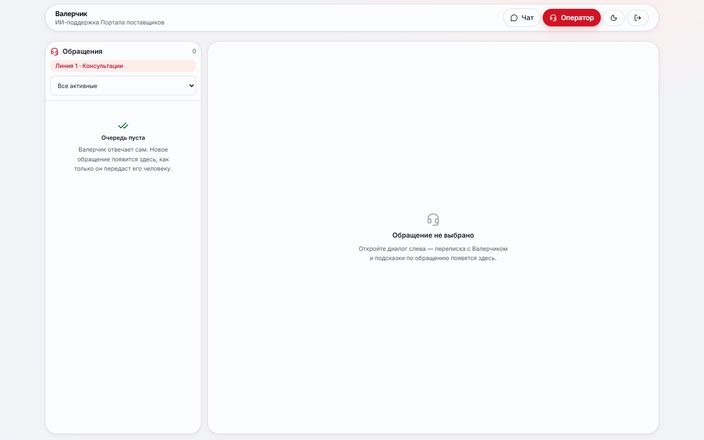
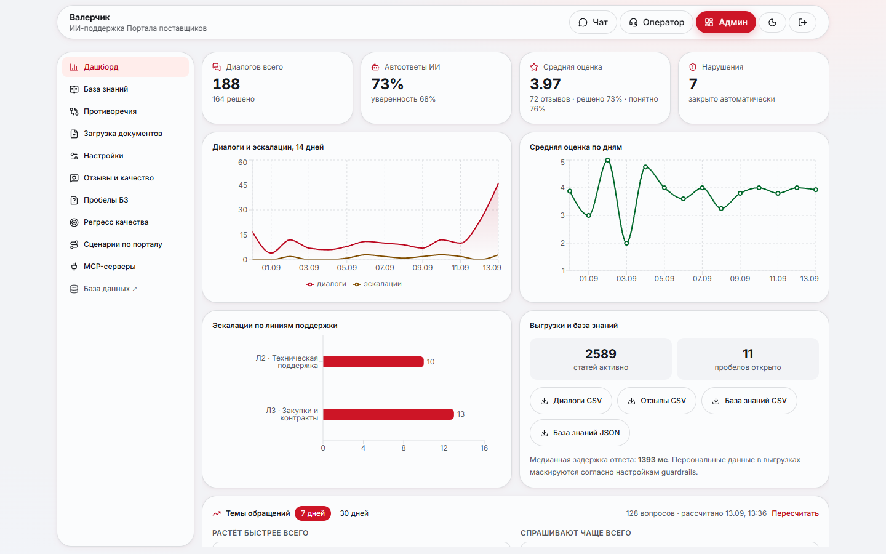
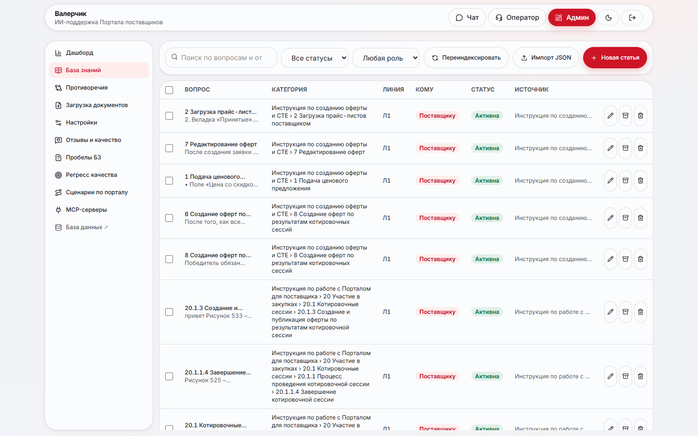
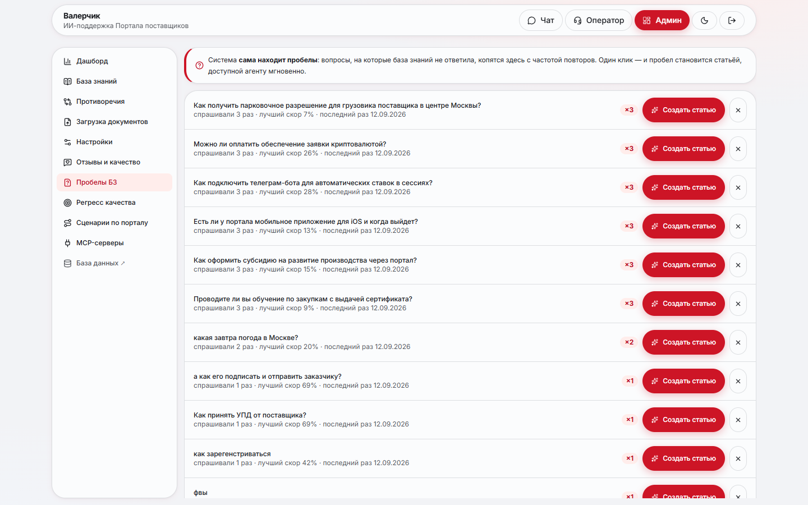
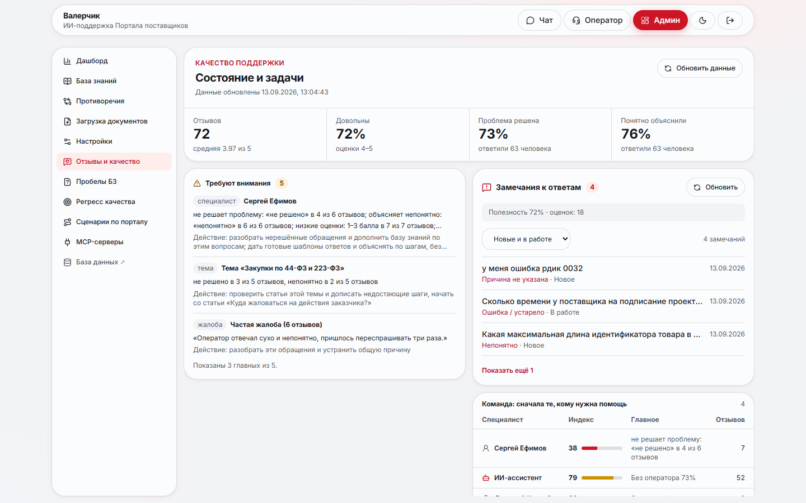
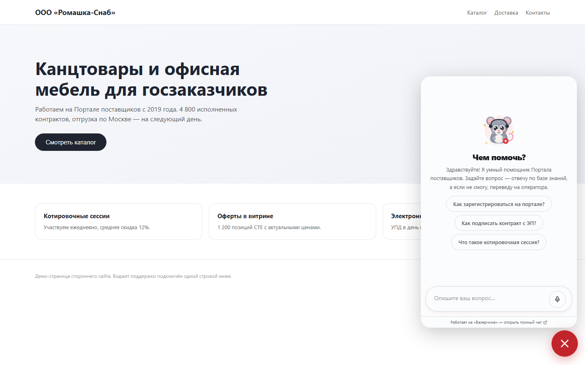

# Валерчик — ИИ-поддержка Портала поставщиков

Валерчик отвечает поставщикам и заказчикам [zakupki.mos.ru](https://zakupki.mos.ru) по базе знаний
портала и показывает, из какой статьи взят ответ. Если ответа в базе нет, он честно отказывает и
предлагает оператора. Обращение он передаёт нужной линии поддержки, а оператору готовит черновик
ответа. Базу знаний Валерчик собирает сам из инструкций в PDF и выгрузки обращений техподдержки.
Все настройки меняются из админки без перезапуска.

Модель — **qwen3.8:27b** через OpenAI-совместимый API Ollama. Эмбеддинги, классификатор, фильтр
токсичности, распознавание и синтез речи работают локально на открытых моделях.



## Цифры стенда

| Что | Сколько | Откуда число |
|---|---|---|
| Статей в базе знаний | 2 589 | 6 PDF-инструкций портала и выгрузка обращений СТП за 2026 год, разобраны автоматически |
| Векторов в индексе | 8 951 | Qdrant, эмбеддинги `sergeyzh/BERTA` (768), статьи порезаны на фрагменты |
| Верный источник в ответе на вопросы по инструкциям | 82 % (было 39 %) | замер на 275 вопросах, старый поиск против текущего, подробности ниже |
| Ответы с иллюстрацией из инструкции | 61 % (было 30 %) | тот же замер, вопросы по инструкциям |
| Честный отказ на вопросы не по теме | 100 % | тот же замер, 15 вопросов |
| Эталонов золотого набора | 43 + 1 885 | 43 перефраза с эталонами из статей базы + 1 885 обращений из выгрузки СТП |
| Сценариев «покажу, куда нажать» | 14 | расширение ведёт по живому zakupki.mos.ru, `backend/app/guides/portal.json` |
| Настроек, которые меняются на лету | 137 | админка → «Настройки», применяются на всех инстансах через Redis |
| Тестов | 1 542 + 243 | pytest (бэкенд, 105 файлов) и vitest (фронтенд, 43 файла) |
| Сервисов в `docker-compose.yml` | 18 | 11 в базовом стеке, остальные — профили `voice`, `docs`, `rerank`, `s3`, `ollama` |

## Как это выглядит

| | |
|---|---|
|  |  |
| Стартовый экран: маскот, подсказки, выбор роли | Ответ по базе: шаги, источники, уверенность, оценка ответа |
|  |  |
| Опечатка исправлена на виду, оригинал — по кнопке | Рабочее место оператора: очередь по линиям, черновик ответа |
|  |  |
| Дашборд: обращения, темы, что выросло за неделю | База знаний: статьи, источник, роль, иллюстрации |
|  |  |
| Пробелы базы: вопросы без ответа с частотой, в статью одним кликом | Оценки ответов, причины недовольства, что поправить |
|  |  |
| Расширение подсвечивает кнопку прямо на zakupki.mos.ru | Виджет на любом сайте одной строкой `embed.js` |

## Запуск

```bash
./start.sh                 # Linux / macOS: весь стек
./start.sh --voice         # + распознавание и синтез речи
./start.sh --ollama        # + своя qwen3.8:27b рядом со стеком (флаг, см. ниже)
.\start.ps1 -Voice -Ollama # то же на Windows
```

Откройте http://localhost:8090: чат — `/`, оператор — `/operator`, админка — `/admin`. Пароли
`admin` и `op_maria` скрипт генерирует при первом запуске и печатает в консоль, они же лежат в `.env`.
Первый старт скачивает модель эмбеддингов, дайте ему 1–2 минуты.

Без Docker работает lite-режим: `cd backend && uv run uvicorn app.main:app --port 8090`. Вместо
PostgreSQL, Redis и Qdrant там SQLite, fakeredis и индекс в памяти, а без ключа LLM отвечает
детерминированный mock. Этот же режим гоняют тесты и CI.

### Модель: qwen3.8:27b и флаг `ollama`

По умолчанию стек ходит к модели по адресу из `.env`, например на отдельный GPU-сервер:

```
LLM_BASE_URL=http://<gpu-сервер>:<порт>/v1
LLM_API_KEY=...
LLM_MODEL=qwen3.8:27b
```

Если своей модели нет, её разворачивает флаг `./start.sh --ollama` (или `COMPOSE_PROFILES=ollama`).
Профиль поднимает Ollama, один раз скачивает `qwen3.8:27b` (Q4_K_M, около 18 ГБ) и, если адрес
модели в `.env` пустой, сам прописывает `http://ollama:11434/v1`. Без флага ничего не скачивается.
На хосте с NVIDIA добавьте сервису `ollama` строку `gpus: all`, иначе модель считается на CPU.

Проверенная конфигурация: одна RTX 5090 (32 ГБ), квантование Q4_K_M, контекст 262 144 токена,
кэш контекста q8_0 с flash attention — модель целиком помещается в видеопамять (29,3 из 32,6 ГБ).
Рассуждения модели регулирует настройка `agent.reasoning_effort`, по умолчанию `none`: так Qwen
отвечает быстрее и реже дописывает от себя.

## Что умеет

### Ответы по базе знаний

Поиск гибридный: смысловые векторы BERTA в Qdrant и BM25 по словам сливаются через Reciprocal
Rank Fusion, отдельно учитывается совпадение с заголовком статьи и роль собеседника. До поиска
запрос чинится: опечатки правятся по словарю самой базы («зарегестрироваться» → «зарегистрироваться»),
сокращения раскрываются по глоссарию инструкций (УПД, КС, МЧД). Найденные фрагменты получает
ReAct-агент на pydantic-ai. Если их мало, он переформулирует запрос и ищет ещё до двух раз, и
только потом отказывает.

Ответ приходит со ссылками на статьи и уверенностью. Если в базе есть готовая авторская формулировка,
она отдаётся дословно: номера разделов и порядок шагов регламента не пересказываются. Ниже порога
уверенности бот не угадывает, а предлагает оператора. Защита ответа сверяет с источником кнопки,
сроки, суммы, телефоны и названия в кавычках. Выдуманный факт не доходит до пользователя — вместо
него показывается текст статьи.

Иллюстрации из инструкций привязаны к тексту по авторской нумерации: фрагмент «нажмите (Рисунок 26 (2))»
получает именно рисунок 26. В ответе картинка открывается крупно по клику.

### Понимание сообщения

- **Забытая раскладка**: «Rfr pfhtubcnhbhjdfnmcz» → «Как зарегистрироваться». Решение принимается
  по частотным парам букв, поэтому «hello» и «UPD 2024» остаются как есть.
- **Опечатки**: та же правка, по которой искал бот, видна прямо в сообщении. Маскот выбегает к
  пузырю и чинит текст гаечным ключом, оригинал открывается кнопкой «посмотреть оригинал».
- **Роль собеседника**: поставщик или заказчик. У двух сторон сделки разные инструкции, поиск
  отдаёт статьи своей роли. Роль понимается из слов («я заказчик»), а при споре двух статей бот
  переспрашивает, вместо того чтобы отвечать наугад.
- **Контекст страницы**: виджет передаёт раздел портала, с которого задан вопрос. Query-строку
  он не передаёт никогда — портал кладёт туда номера заявок и ИНН.

### Защита общения

Мат ловится с обфускацией: «х*у_й», «c у к а», латиница, цифры, невидимые разделители, растянутые
буквы и набор в английской раскладке. Словарь из примерно 3,9 тыс. производных, pymorphy3 узнаёт
любую форму слова. Грубость без мата оценивают взвешенные правила: сначала предупреждение, при
повторе обращение завершается. Последний слой — нейросеть `cointegrated/rubert-tiny-toxicity`
на CPU для того, что правила пропустили. Если она упала, чат продолжает работать на правилах.
Отдельно работают эвристики prompt-инъекций и маскирование персональных данных в выгрузках.

### Оператор и маршрутизация

Классификатор на эмбеддингах определяет линию поддержки и адресата по регламенту. Он дообучается
фоновой задачей на статьях и реальных диалогах и подменяется без рестарта. Оператор видит очередь
своей линии, к каждому сообщению пользователя получает подсказки из базы и готовый черновик ответа
по всей переписке. Отправляет черновик всегда человек. Хороший ответ оператора одной кнопкой
становится статьёй базы. Брошенное обращение возвращается в очередь и не достаётся тому же оператору.

Пользователь без регистрации видит «Мои обращения»: статус словами, кому передано и пометку о новом
ответе, если специалист написал, пока человек был в другом диалоге.

### База знаний, которая собирается сама

Каждый файл разбирает подходящий источник. Методичка режется по заголовкам, и к каждому куску
модель формулирует вопрос. Выгрузка «вопрос — ответ» импортируется напрямую. Книга Excel
разбирается по листам, JSON находится и в глубине структуры, папка скриншотов превращается в статьи,
где ответ — сама картинка. Колонки узнаются по содержимому, а не только по названию. Трёхсотстраничная
инструкция даёт около 600 статей. Новый формат подключается отдельным файлом-источником:
[docs/INGEST.md](docs/INGEST.md).

Вопросы без ответа копятся как «пробелы базы» с частотой повторов, один клик превращает пробел
в статью. Противоречия между статьями (разные сроки, суммы, порядок действий) проверяются в фоне
при каждом изменении статьи: [docs/SOURCE_CONFLICTS.md](docs/SOURCE_CONFLICTS.md). Переиндексация
идёт blue/green через алиасы Qdrant, поиск не прерывается.

### Расширение, виджет, голос, MCP

- **Расширение для браузера** (Chrome, Edge, Firefox, MV3): тот же чат на zakupki.mos.ru. На 14
  частых задач Валерчик показывает, куда нажимать: подсвечивает элемент, ставит рядом карточку и
  переживает переходы между страницами. Портал разобран заранее, без VLM:
  [docs/EXTENSION.md](docs/EXTENSION.md), [docs/PORTAL_MAP.md](docs/PORTAL_MAP.md).
- **Виджет** на любом сайте одной строкой: [docs/EMBED.md](docs/EMBED.md).
- **Голос** (профиль `voice`): диктовка через faster-whisper и озвучка ответа через Piper, оба на CPU.
  Перед озвучкой с текста снимается Markdown.
- **Каталог товаров** через MCP-сервер `zakupki-mcp`: на «найди ноутбук» бот показывает карточки
  товаров с фото и ценами портала. Наружу работает свой MCP-сервер `mcp-server/` с инструментами
  поддержки для внешних агентов.

### Аналитика и качество

Дашборд группирует вопросы в темы по эмбеддингам, поэтому одна проблема в трёх формулировках
считается одной темой. Там же видно, что выросло к прошлой неделе. Отзывы проходят через анализ
тональности и кластеризацию негатива, плюс строится рейтинг специалистов. После ответа
пользователь ставит оценку и выбирает причину недовольства: «не помогло», «ошибка в ответе». Причина
запускает повторную попытку или передачу оператору.

Регресс качества прогоняется из админки по кнопке. Кроме доли верных ответов отдельно считается доля
уверенных ошибок: это опаснее, чем «не знаю». Какой набор прогонять, решает настройка
`eval.question_set`: `v2` — 43 эталона, сверенных вручную со статьями базы, и 1 885 обращений из
выгрузки СТП. `eval.sample_every=2` прогоняет каждый второй вопрос с сохранением пропорций тем.

## Замеры

**Старый поиск против текущего**, 275 вопросов на стенде с той же базой. В ответе проверялось,
процитирован ли верный источник и есть ли в ответе факты эталона.

| Вид вопросов | Метрика | Было | Стало |
|---|---|---|---|
| По инструкциям (82) | ответил по делу | 94 % | 98 % |
| По инструкциям (82) | процитировал верный источник | 39 % | 82 % |
| По инструкциям (82) | факты эталона в ответе | 33 % | 52 % |
| По инструкциям (82) | ответ с иллюстрацией | 30 % | 61 % |
| Реальные вопросы пользователей СТП (150) | ответил по делу | 87 % | 88 % |
| Не по теме (15) | честный отказ | 100 % | 100 % |

**qwen3.8:27b на золотом наборе v2**, 10 вопросов разных тем: 10 из 10 ответов содержат эталонный
фрагмент из статьи, ни один не пришлось заменять текстом статьи, медиана полного ответа 10,5 с
(одна RTX 5090, рассуждения `none`). Прогон по всему набору
v2 запускается из админки.

**Реранкер** (профиль `rerank`, cross-encoder): точность первого места на сложных разговорных
запросах выросла с 2/6 до 4/6 ценой около 0,4 с. Включается тумблером `retrieval.use_reranker`.

## Схемы процессов (BPMN)

Три процесса в BPMN 2.0: обработка обращения, структурирование базы знаний и оценка качества
работы специалистов — [docs/BPMN.md](docs/BPMN.md). Файлы `.bpmn` открываются в Camunda Modeler
и bpmn.io. Схемы и картинки собирает один генератор `scripts/bpmn.py`, CI проверяет, что их не
правили руками.


## Архитектура

```
frontend (React 19 + Vite, nginx)            — чат, оператор, админка
   └─ /api, /ws → api ×N (FastAPI, Python 3.14) — REST + WebSocket, без состояния
        ├─ PostgreSQL 18                     — данные (lite: SQLite)
        ├─ Redis 8                           — кэш, pub/sub настроек и WebSocket, очередь
        ├─ Qdrant 1.19                       — векторный индекс, алиасы blue/green
        ├─ TEI + sergeyzh/BERTA              — эмбеддинги для русского, CPU
        ├─ TEI + rubert-tiny-toxicity        — фильтр токсичности, CPU
        ├─ worker (taskiq)                   — индексация, дообучение, аналитика
        ├─ stt / tts (профиль voice)         — faster-whisper и Piper
        ├─ zakupki-mcp                       — каталог товаров портала по MCP
        └─ LLM: qwen3.8:27b (Ollama)         — внешний GPU-сервер или профиль ollama
```

Каждый слой хранения и поиска имеет боевую и lite-реализацию, поэтому одно и то же приложение
работает в Docker, на ноутбуке без Docker и в CI. API масштабируется `--scale api=N`: nginx
балансирует сам, события WebSocket расходятся между инстансами через Redis.

Резервные копии снимает контейнер `backup` по расписанию из админки: дамп базы, иллюстрации и `.env`.
`make backup` делает копию по требованию, `make restore FROM=…` восстанавливает стенд.

## Тесты и CI

```bash
cd backend
uv run ruff check app tests && uv run ruff format --check app tests
uv run mypy
uv run pytest --cov -q          # гейт покрытия 80 %
cd ../frontend && npm ci && npm test && npm run build
```

CI на каждый push проверяет бэкенд (ruff, mypy, pytest с гейтом покрытия), фронтенд (сверка типов API
со схемой, oxlint, tsc, vitest, сборка, доступность на поднятом стенде), расширение, BPMN, все
профили `docker compose config` и сборку шести образов. Типы ответов API фронтенд руками не пишет:
они генерируются из OpenAPI-схемы самого приложения.

## Структура

```
backend/           FastAPI, ReAct-агент, поиск, разбор источников, тесты
frontend/          React SPA: чат, оператор, админка
extension/         расширение для браузера (MV3)
zakupki-mcp/       MCP-сервер каталога товаров портала
mcp-server/        MCP-сервер поддержки для внешних агентов
stt-service/       распознавание речи (faster-whisper)
tts-service/       синтез речи (Piper)
docparse-service/  разбор PDF с иллюстрациями (docling)
docs/              BPMN, скриншоты, описание разбора данных, расширения и противоречий
scripts/           генератор BPMN, импорт базы знаний портала, бэкапы
```

План реализации и обоснования решений — в [PLAN.md](PLAN.md).
