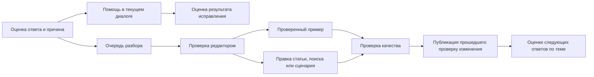

# Оценка ответа, которая помогает исправить проблему

Дата исследования: 12 сентября 2026. Исходный разбор ниже описывает код на `main`, HEAD `d5cebe1`. После согласования первая итерация реализована поверх актуального `main` (`19bfbc8`). Статистики использования нет, поэтому приоритеты остаются продуктовыми гипотезами.

## Контракт первой итерации

- Один актуальный голос владельца диалога на обычный ответ ассистента. Его можно изменить или снять; повтор запроса не увеличивает счётчики. Причина и комментарий необязательны. Звёзды за консультацию считаются отдельно.
- Дизлайк создаёт замечание со снимком вопроса, ответа, роли, контекста и источников на момент оценки. Историческим голосам не приписываются неизвестные дата и причина.
- Пользователь сам выбирает продолжение: объяснение по шагам, уточнение или оператор. Повторное объяснение учитывает замечание и минует выдачу дословной статьи. Новому ответу можно поставить отдельную оценку.
- Сотрудники видят очередь, администратор разбирает замечания и редактирует или создаёт статью. Статус «исправлено» ставится после индексации; «проверено» — после отдельной ручной проверки с пояснением. Правка статьи защищена от перезаписи более новой версии; повтор сохранения после сбоя индексации не создаёт ещё одну статью.
- Оценки не меняют автоматически текст БЗ или ранжирование. Счётчики показывают долю полезных среди оценённых ответов вместе с числом оценок.
- Выкладка только пушем в Git и существующим Deploy workflow. Локальные тесты не запускаются по рабочему соглашению; сценарии проверяются на сервере после выкладки. Статические проверки и сборка выполняются локально.

Предлагаю развивать существующие оценки в двух направлениях: помочь человеку после неудачного ответа и дать команде воспроизводимый случай для исправления. Первая версия: причина дизлайка, подходящее продолжение диалога, очередь разбора и связь с исправлением статьи. Рекомендация — делать эту версию; влияние оценок на ранжирование отложить до накопления и проверки данных.

## Что было реализовано до доработки

| Механизм | Что делает код сейчас | Источник |
| --- | --- | --- |
| 👍/👎 у ответа | Отправляет оценку конкретного сообщения, показывает благодарность. После успешной отправки изменить оценку в интерфейсе нельзя. | [Bubble.tsx](/Users/felicuss/Documents/tender_nn_2026/frontend/src/pages/chat/Bubble.tsx:46), [кнопки](/Users/felicuss/Documents/tender_nn_2026/frontend/src/pages/chat/Bubble.tsx:192) |
| Дизлайк → пробел БЗ | Записывает `Message.meta.rating`, находит предыдущую реплику пользователя, создаёт или увеличивает `KBGap`, публикует событие операторам. Сам диалог в очередь поддержки не переводит. | [feedback_flow.py](/Users/felicuss/Documents/tender_nn_2026/backend/app/chat/feedback_flow.py:22) |
| Оценка консультации | 1–5 звёзд и комментарий. Предлагается при закрытии диалога и после настраиваемой паузы; значение паузы по умолчанию — 120 секунд. | [Rating.tsx](/Users/felicuss/Documents/tender_nn_2026/frontend/src/pages/chat/Rating.tsx:36), [useRatingPrompt.ts](/Users/felicuss/Documents/tender_nn_2026/frontend/src/pages/chat/useRatingPrompt.ts:51), [настройка](/Users/felicuss/Documents/tender_nn_2026/backend/app/dynamic_settings.py:632) |
| Аналитика отзывов | Звёзды попадают в `Feedback`: средние оценки, разрез по ИИ/операторам, кластеризация негативных комментариев, сводный отчёт. Оценки отдельных сообщений этот отчёт не читает. | [feedback.py](/Users/felicuss/Documents/tender_nn_2026/backend/app/services/feedback.py:135) |
| Пробел → новая статья | Администратор пишет ответ и публикует статью; сервер индексирует её. Можно также отклонить пробел. | [kb_gaps.py](/Users/felicuss/Documents/tender_nn_2026/backend/app/services/kb_gaps.py:38), [admin.py](/Users/felicuss/Documents/tender_nn_2026/backend/app/routers/admin.py:200) |
| Проверка качества | Есть золотой набор вопросов и дополнения через `eval.extra_questions`; оцениваются ожидаемые фрагменты ответа и уверенные ошибки. | [quality.py](/Users/felicuss/Documents/tender_nn_2026/backend/app/services/quality.py:49) |

Лайк сейчас сохраняется, но не меняет подбор источников и генерацию. Поиск использует близость запроса, контекст страницы, роль пользователя, свежесть и опциональный реранкер; рейтинг ответа в расчётах не участвует. [retrieval.py](/Users/felicuss/Documents/tender_nn_2026/backend/app/services/retrieval.py:331)

В README есть «дообучение на лету», но существующая задача дообучает классификатор линий поддержки по статьям и эскалированным обращениям. Это отдельный механизм: он не обучает языковую модель по лайкам. [jobs.py](/Users/felicuss/Documents/tender_nn_2026/backend/app/tasks/jobs.py:191)

## Для кого и какую проблему решаем

Поставщик или заказчик получил консультацию, попробовал выполнить действие и застрял. Ему нужно продолжить решение с учётом неудачи. Редактору БЗ нужно понять, что исправлять: содержание статьи, поиск, объяснение, сценарий на портале или интеграцию. Руководителю поддержки нужно видеть частоту и результат исправлений.

Сейчас все дизлайки трактуются одинаково — как пробел в знаниях. Но «слишком сложно» не означает, что статья неверна, а «кнопки нет» может означать другую роль пользователя или изменение интерфейса. Главная недостающая часть — причина оценки и действие по этой причине.

## Как это должно выглядеть для пользователя

Под обычным завершённым ответом остаётся «Ответ помог? 👍 👎». Оценка сохраняется сразу; причина и комментарий необязательны. Оценку можно изменить или снять, включая после перезагрузки. Для звёзд остаётся отдельный смысл: качество всей консультации.

После 👎 открывается компактный блок «Что не получилось?»:

| Причина | Что предложить сейчас | Что получает команда |
| --- | --- | --- |
| Непонятно / слишком сложно | «Объяснить по шагам» с опорой на те же источники | Сигнал об изложении; при повторах — задача на упрощение инструкции |
| Ответ не на мой вопрос | Уточнить ситуацию или роль, затем повторить поиск | Случай ошибки подбора источника с исходным вопросом и контекстом |
| В ответе ошибка / устарело | Уточнить неверный фрагмент, предложить оператора | Задача на проверку процитированных материалов |
| Сделал по инструкции, не работает | Уточнить шаг; предложить существующий сценарий по порталу, если он подходит, или оператора | Случай для проверки инструкции, сценария либо проблемы портала |
| Другое | Необязательный комментарий и возможность позвать оператора | Случай без заранее назначенной причины |

Нажатие оценки само по себе не запускает повторную генерацию и не закрывает диалог. Человек выбирает следующее действие. После нового ответа спрашиваем, помогло ли исправление, и сохраняем связь с исходным ответом. Повторная неудача должна давать простой выход к оператору, без обязательного цикла уточнений.

Текст подтверждения соответствует выполненному действию: «Оценка сохранена» после записи, «Замечание добавлено на проверку» после создания задачи, «Диалог передан оператору» только после реального перевода.

Пример сценария для обсуждения: человек спрашивает о создании оферты, получает инструкцию и выбирает «Сделал по инструкции, не работает», потому что не видит кнопку. Бот уточняет раздел и роль; при наличии подходящего сценария предлагает показать нужный шаг. Если проблема остаётся, оператор получает историю и конкретное место, где человек застрял. Редактор видит, повторяется ли проблема у других пользователей.

## На что прикрутить влияние оценки

Приоритеты и трудоёмкость ниже — относительная оценка по коду, без календарного обещания.

| Очерёдность | Идея | Польза и следующий шаг | Трудоёмкость |
| --- | --- | --- | --- |
| 1 | Помощь после дизлайка | Причины + объяснение по шагам, уточнение или оператор. Видимый результат оценки в том же диалоге. | Средняя |
| 1 | Очередь проблемных ответов | Показывать вопрос, ответ, причину, контекст, источники; дать редактору исправить существующую статью или создать новую. | Средняя |
| 2 | Проверенные случаи в набор качества | Разобранную ошибку превращать в пример с правильным ответом и критериями. Проверять, что исправление устранило её и сохранило качество остальных сценариев. | Средняя |
| 2 | Аналитика по темам и версиям | Показывать, где стало хуже после изменения статьи, модели или промпта; сравнивать варианты на сопоставимых обращениях. | Средняя |
| 3 | Осторожная корректировка поиска | Использовать подтверждённые оценки источников как ограниченный дополнительный сигнал среди подходящих кандидатов. | Высокая |
| 3 | Подсказки по подключению возможностей | Группировать случаи «нет актуальных данных» и «нужно выполнить действие» в предложения о новом MCP-инструменте или сценарии. | Средняя/высокая |

Для положительных оценок тоже есть применение: находить удачные объяснения для копилота оператора и кандидатов в эталонные примеры. Перед повторным использованием требуется проверка содержания и удаление персонального контекста. Лайк говорит о полезности для конкретного человека, но сам по себе не подтверждает правильность регламента.

Более дальняя версия: редактор открывает карточку «этот ответ не помог в нескольких независимых диалогах», видит предполагаемую причину и черновик исправления; после проверки публикует изменение, а система связывает его с результатами проверок и последующими оценками. Пользователь в сохранённом диалоге может увидеть статус своего замечания. Отдельные email/push-уведомления — самостоятельная функция с настройкой согласия.

## Как связать оценку и исправление

В очереди нужны статусы «новое → в работе → исправлено → проверено» и «отклонено» с пояснением. Публикация статьи и успешная проверка ответа — разные события. Одно исправление может закрыть несколько связанных замечаний.

Группировать стоит по теме, роли и источникам. Для приоритета показывать число независимых диалогов, долю отрицательных оценок среди оценённых ответов, объём ответов по теме и тяжесть подтверждённой проблемы. Один плохой отзыв из одного и десять плохих из тысячи — разные ситуации; ни одна из них не описывается одним абсолютным счётчиком.

Полезно различать диагноз редактора: нет знания; знание устарело; найден не тот источник; ответ непонятен; сломан сценарий; не хватает данных/действия; проблема самого портала. Причина, выбранная пользователем, служит отправной точкой, а не окончательным диагнозом.

## Что нужно учесть именно в этом репозитории

1. **Сохранить отдельную сущность оценки ответа.** Предлагаемые данные: `session_id`, `message_id`, голос, причина, комментарий, даты создания/изменения. Одна актуальная оценка владельца на сообщение; повтор запроса не добавляет голос. Сервер уже проверяет владение сессией — этот механизм сохраняется. Для перехода можно читать старое `meta.rating`; у исторических оценок нет причины и достоверного времени голосования, их нельзя придумывать.

2. **Сохранить контекст, по которому был построен ответ.** Нужны ссылка на исходный вопрос, эффективный запрос после уточнений, роль, раздел портала, источники с версиями или снимками, путь ответа (`verbatim`/агент/MCP), версия модели, промпта и настроек. Часть данных уже есть в `Message` и `Turn`, но всё вместе для воспроизведения не сохраняется. Брать только последнюю реплику пользователя недостаточно: это может быть «я заказчик», уточняющее более ранний вопрос. [turn.py](/Users/felicuss/Documents/tender_nn_2026/backend/app/chat/turn.py:16), [chat.py](/Users/felicuss/Documents/tender_nn_2026/backend/app/services/chat.py:290)

3. **Передавать обратную связь в продолжение диалога.** Сейчас агент получает из истории только роль и текст; `meta.rating` не передаётся. Предлагается явный контекст: какой ответ не помог, почему и какое действие выбрано. Комментарий пользователя остаётся пользовательскими данными. [chat.py](/Users/felicuss/Documents/tender_nn_2026/backend/app/services/chat.py:339)

4. **Продумать повтор для дословного ответа.** Быстрый путь возвращает текст статьи до вызова LLM. Для «объяснить по шагам» нужен отдельный режим, использующий документ и исходный вопрос, иначе повтор может отдать тот же текст. Пересказ нельзя помечать как дословную цитату. [steps.py](/Users/felicuss/Documents/tender_nn_2026/backend/app/chat/steps.py:72)

5. **Исправлять существующие статьи.** Текущий путь пробела создаёт новую статью, хотя источник мог уже существовать. Очередь замечаний должна связываться со статьёй и её исправлением. `KBGap` оставить для отсутствующего знания, а не любой формы недовольства. [kb_gaps.py](/Users/felicuss/Documents/tender_nn_2026/backend/app/services/kb_gaps.py:38)

6. **Устранить повторный учёт.** Каждый запрос с `-1` сейчас увеличивает `KBGap.hits`, даже если сообщение уже оценено. Звёзды каждый раз создают новую строку `Feedback`. Замена или снятие оценки должна менять актуальные агрегаты, а повтор доставки — не менять их. Запись оценки и задачи разбора должна быть согласованной; сбой WS-уведомления не должен превращать сохранённую оценку в повторное замечание. [feedback_flow.py](/Users/felicuss/Documents/tender_nn_2026/backend/app/chat/feedback_flow.py:22)

7. **Повторные жалобы должны быть видны.** `_record_gap` увеличивает существующую запись независимо от статуса, а список показывает только `open`. Следовательно, новая жалоба после `converted`/`dismissed` может остаться вне списка открытых пробелов. Нужно различать повтор старого случая и новую проблему после изменения статьи. [knowledge.py](/Users/felicuss/Documents/tender_nn_2026/backend/app/chat/knowledge.py:144)

8. **Подключить оценки сообщений к аналитике.** Звёзды и лайки отвечают на разные вопросы, поэтому показывать их раздельно. В смешанной консультации оценка сейчас относится к оператору при наличии `operator_id`; это не даёт точного разделения вклада бота и человека. [feedback_flow.py](/Users/felicuss/Documents/tender_nn_2026/backend/app/chat/feedback_flow.py:79)

9. **Проверять полный сценарий ответа.** Существующий прогон качества вызывает агента напрямую и ищет ожидаемые фрагменты текста. Он полезен как основа, но не проверяет быстрый дословный путь и весь сценарий восстановления после дизлайка. Новые проверенные случаи должны сохранять необходимые роль и контекст. Запуск проверок в рамках этого исследования не выполнялся. [quality.py](/Users/felicuss/Documents/tender_nn_2026/backend/app/services/quality.py:83)

10. **Разделить популярность и уверенность.** При будущем влиянии оценок на поиск не повышать отображаемую уверенность и не обходить порог отказа из-за лайков. Не штрафовать все процитированные статьи за непонятный ответ: неверным могло быть изложение. В коде уже разделены ключ ранжирования и оценка уверенности — это полезная опора. [retrieval.py](/Users/felicuss/Documents/tender_nn_2026/backend/app/services/retrieval.py:341)

## Предлагаемая первая итерация

Завершённый объём: сохраняем причину и исправляем повторный учёт, даём выбрать продолжение после 👎, показываем связанные случаи в админке и позволяем привязать их к правке существующей статьи или новому пробелу. Показываем результат выбранного действия и собираем оценку повторного ответа.

Пользовательская часть затронет `Bubble`, `useChatSession` и контракты API. Серверная — модель оценок, `feedback_flow`, контекст ответа и операторскую передачу. Админка — ленту замечаний, редактор БЗ и простые агрегаты. Виджет использует общий `ChatPage`, поэтому базовый интерфейс оценки можно сделать общим для полного чата и виджета. [WidgetPage.tsx](/Users/felicuss/Documents/tender_nn_2026/frontend/src/pages/WidgetPage.tsx:13)

Следующая итерация — перенос разобранных случаев в набор качества и сравнение результатов исправлений. Автоматическая публикация пользовательских комментариев в БЗ, дообучение LLM и изменение ранжирования не входят в предложенную первую итерацию.

Критерий готовности первой версии: человек может объяснить, что не помогло, получить подходящее продолжение, а редактор — дойти от его замечания до конкретного исправления. Повтор запроса не создаёт новую жалобу; смена оценки корректно отражается в статистике; уже закрытое замечание не скрывает новую проблему.

## Как понять, что стало лучше

| Показатель | Как считать и читать |
| --- | --- |
| Охват оценками | Число ответов с актуальной оценкой / число ответов, доступных для оценки. Отсутствие оценки — неизвестный результат. |
| Полезность ответа | 👍 / (👍 + 👎), рядом объём выборки; отдельно по роли, теме и пути ответа. |
| Помощь после неудачи | Доля положительно оценённых повторных ответов среди повторных ответов с оценкой. Рядом — доля повторных ответов, которые вообще оценили, и число переходов к оператору. |
| Скорость исправления | Время от появления замечания до связанного исправления и отдельно до его проверки. |
| Повторяемость проблемы | Жалобы по той же теме/причине после исправления с учётом версии источника и объёма ответов. Снижение до/после само по себе не доказывает причинность. |
| Качество подтверждённых случаев | Устранение разобранной ошибки при сохранении качества других примеров, включая долю уверенных неверных ответов. |

Целевые проценты стоит назначить после базового замера. Доля ответов без оператора сама по себе не подтверждает решение: человек мог уйти, так и не получив помощи.

## Внешние ориентиры и открытые предположения

В официальной документации Intercom Fin рекомендации по неудачным консультациям разделены на проблемы контента, нехватку данных и нехватку действий, с привязкой к конкретным разговорам. Это полезный ориентир для диагностики причин. Подключение Intercom для предложенной версии не требуется. [Intercom, материал от 14 мая 2026, прочитан 12 сентября 2026](https://www.intercom.com/help/en/articles/11390088-optimize-fin-instantly-with-the-help-of-ai)

LangSmith описывает очереди экспертного разбора, направление туда случаев с низкими оценками и перенос исправленных примеров в набор данных. Для нашего проекта из этого следует практическая идея: связать уже существующие отзывы, редактор БЗ и проверку качества. Сам LangSmith для этого подключать необязательно. [LangSmith, документация прочитана 12 сентября 2026](https://docs.langchain.com/langsmith/annotation-queues)

Неизвестны объём реальных обращений, доля получаемых оценок, доступность редактора БЗ и наличие данных для надёжного связывания повторных посещений. При отсутствии аккаунта можно гарантировать одну оценку на сообщение в сессии, но нельзя честно называть разные сессии разными людьми. Поэтому начинаем с прозрачной очереди и ограниченного влияния, а силу автоматических решений определяем после накопления данных.

Следующий шаг: согласовать первую итерацию «причина → помощь → разбор → исправление» и затем подготовить реализацию по этим границам.
