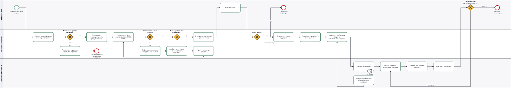
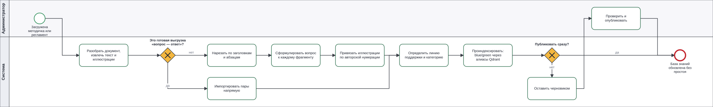
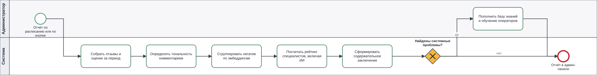

# Схемы процессов в нотации BPMN

Три процесса, которые закрывает система. Файлы `.bpmn` — валидный BPMN 2.0 с координатами
(BPMN DI), они открываются в [bpmn.io](https://demo.bpmn.io/), Camunda Modeler и любом
редакторе, понимающем стандарт. Рядом лежит `.svg` — та же схема картинкой, для презентации
и README.

| Процесс | Схема | Исходник |
|---|---|---|
| Обработка обращения в поддержку | [support.svg](bpmn/support.svg) | [support.bpmn](bpmn/support.bpmn) |
| Структурирование базы знаний | [knowledge.svg](bpmn/knowledge.svg) | [knowledge.bpmn](bpmn/knowledge.bpmn) |
| Оценка качества работы специалистов | [quality.svg](bpmn/quality.svg) | [quality.bpmn](bpmn/quality.bpmn) |

Схемы генерируются кодом:

```bash
uv run --project backend python scripts/bpmn.py
```

Раскладка (координаты фигур, изломы стрелок) считается из декларативного описания «колонка ×
дорожка» в самом скрипте. Причина простая: `.bpmn` и `.svg` собираются из одного описания и
не могут разойтись — картинка в презентации всегда показывает ровно то, что лежит в исходнике
схемы. Зависимостей у скрипта нет, только стандартная библиотека.

## 1. Обработка обращения



Три дорожки: пользователь, ИИ-агент, оператор. Ключевые развилки — ровно те, что требует ТЗ:

- **Нарушение правил общения?** Детектор мата стоит до всего остального: обращение
  закрывается автоматически, пользователь получает уведомление о причине.
- **Уверенность выше порога?** Ниже порога система не угадывает: сообщает, что ответа нет,
  предлагает оператора и фиксирует вопрос как пробел базы знаний. Порог правится в админке
  на лету.
- **Тема определяется однозначно?** Если две статьи из разных тем стоят вплотную — уточняющий
  вопрос вместо ответа наугад, с возвратом в поиск.
- **Ответ помог?** Отрицательная оценка — такой же вход в эскалацию, как и низкая уверенность.
- **Таймер принятия 60 секунд** действует на назначение, а не на активную работу. Отказ или
  таймаут возвращает обращение в очередь, сохраняя общее время ожидания; молчание в уже
  принятом диалоге само по себе владельца не меняет.
- **Подтверждение решения пользователем** обязательно: «Помогло» завершает обращение,
  «Не решено» возвращает его прежнему онлайн-сотруднику либо в очередь. Автозакрытия по
  молчанию нет.

Ответы сотрудников и использование черновиков фиксируются как данные для анализа. Они не
публикуются в базу знаний и не становятся обучающими примерами без отдельной проверки.

## 2. Структурирование неформализованной базы знаний



Развилка «это готовая выгрузка вопрос — ответ?» отделяет прямой импорт от разбора методички.
Во второй ветке документ режется по заголовкам и абзацам, к каждому фрагменту LLM формулирует
вопрос, который он закрывает, а линию подсказывает тот же классификатор, что маршрутизирует
обращения. Индексация — blue/green через алиасы Qdrant, поиск при этом не останавливается.

## 3. Оценка качества работы специалистов



Отзывы → тональность → кластеризация негатива по эмбеддингам → рейтинг специалистов (ИИ
ранжируется наравне с операторами) → содержательное заключение о системных проблемах.
Кластеризация здесь принципиальна: одна проблема в трёх формулировках должна давать один
пункт заключения, а не три редкие жалобы.
