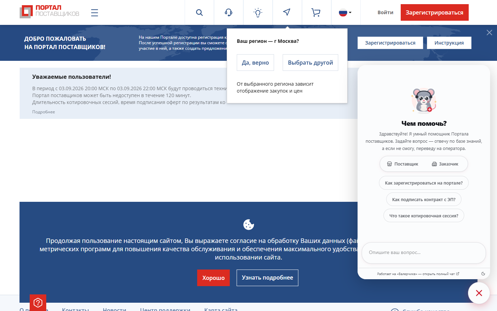
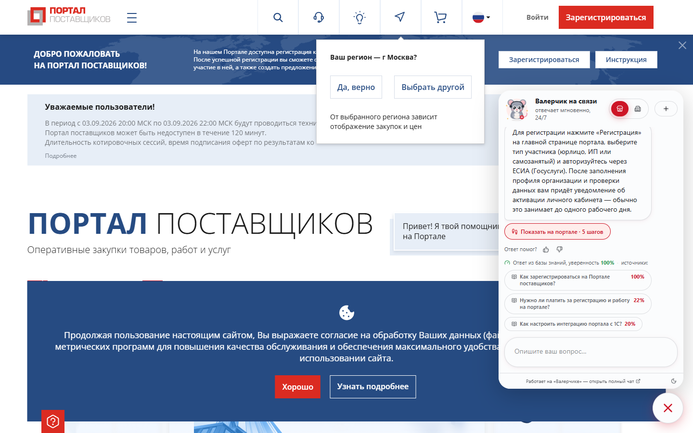
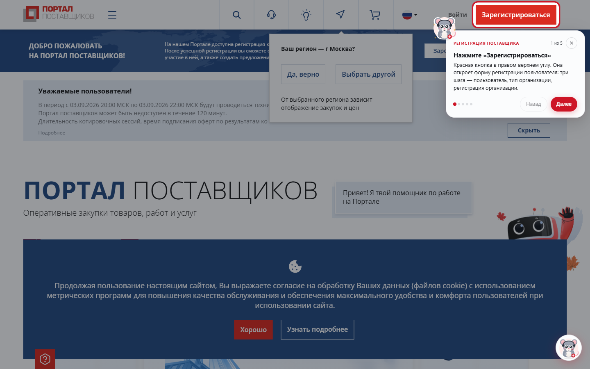
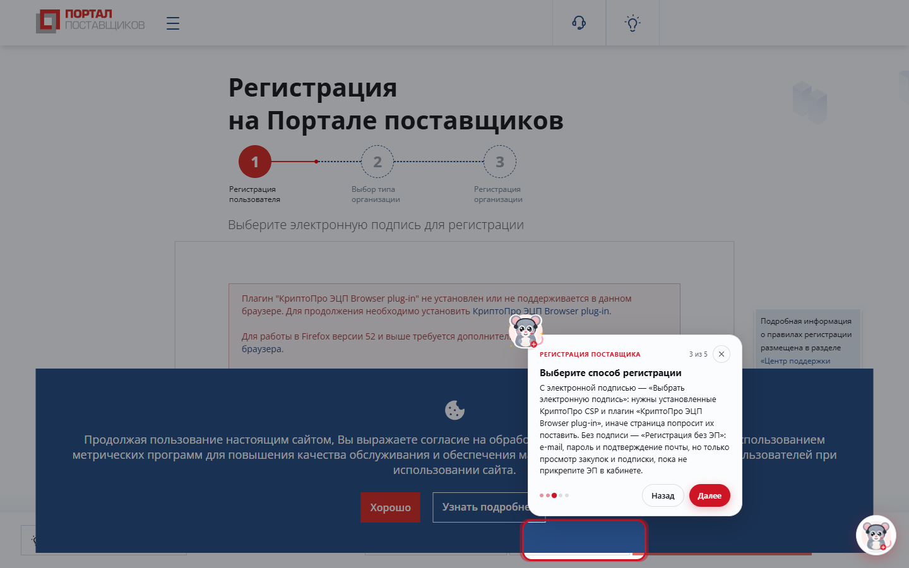
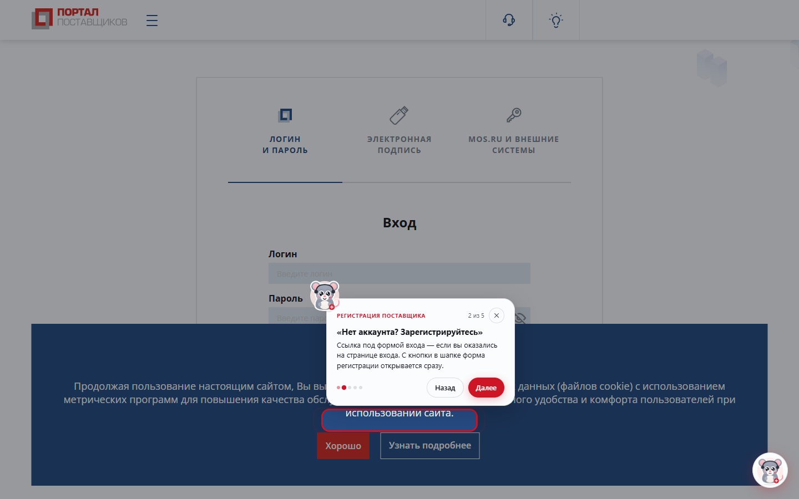

# Расширение для браузера: Валерчик на zakupki.mos.ru

Расширение для Chrome / Edge / Firefox (Manifest V3) вставляет на страницы
Портала поставщиков ту же кнопку и тот же чат, что и виджет `embed.js`, — а на
вопросы вроде «как зарегистрироваться» или «как создать котировочную сессию»
Валерчик **выходит на страницу и показывает по шагам, куда нажимать**:
подсвечивает элемент, ставит рядом карточку с пояснением и сам перебегает от
шага к шагу. Переходы между страницами (главная → вход Keycloak → кабинет)
подсказка переживает.

| | |
|---|---|
|  |  |
| Чат в стиле Валерчика поверх портала, ползунок роли | Ответ по базе знаний и кнопка сценария |
|  |  |
| Подсветка кнопки «Зарегистрироваться», маскот у карточки | После клика — форма регистрации Keycloak, движок сам перескочил к нужному шагу |
|  | |
| «Назад» ведёт на форму входа: ссылка «Зарегистрируйтесь» подсвечена | |

## Почему не VLM

Распознавать экран моделью — секунды на шаг и внешний вызов на каждый экран.
Вместо этого портал разобран заранее: маршруты и заголовки страниц вынуты из
бандла, селекторы сняты с живого DOM (см. [PORTAL_MAP.md](PORTAL_MAP.md)), а
сценарии описаны списком шагов с локаторами по убыванию надёжности
(`data-testid` → стабильный префикс styled-компонента → ссылка → текст).
Поиск элемента занимает миллисекунды и не ходит в сеть; цена — сценарии надо
обновлять, когда портал меняет вёрстку, и на это есть e2e-проверка.

## Установка

Один шаг сборки нужен: чат внутри расширения — это виджет фронтенда, и он
лежит в `extension/widget/`, которого нет в репозитории (каталог в `.gitignore`,
чтобы сборка не попадала в историю). Без него окно чата в расширении пустое.

```bash
cd frontend && npm ci && npm run build:extension   # соберёт extension/widget/
```

Дальше папка `extension/` загружается как есть:

- **Chrome / Edge**: `chrome://extensions` → «Режим разработчика» →
  «Загрузить распакованное» → папка `extension/`.
- **Firefox** (121+): `about:debugging#/runtime/this-firefox` → «Загрузить
  временное дополнение» → `extension/manifest.json`. Для постоянной установки
  нужна подпись на AMO; `browser_specific_settings.gecko.id` уже задан.

По умолчанию расширение ждёт сервер Валерчика на `http://localhost:8090`
(docker-стек или `uv run uvicorn app.main:app --port 8090` в lite). Другой
адрес — в настройках расширения (клик правой кнопкой по иконке → «Параметры»).
Сервер вне localhost должен быть **на https**: портал открыт по https, и
смешанный контент браузер не пропустит.

Кнопка на панели браузера открывает чат на портале, а на любой другой вкладке
— сам портал.

## Как это устроено

```
extension/
  manifest.json          MV3; background объявлен и как service_worker (Chrome), и как scripts (Firefox)
  background.js          кнопка на панели: открыть чат / открыть портал
  chat.html + chat-frame.js   страница расширения с виджетом из widget/ (собирается npm run build:extension)
  widget/                собранный виджет (в git не хранится: артефакт сборки)
  content/
    styles.js            токены и стили в Shadow DOM — те же, что в global.css
    mascot.js            Валерчик на чистом JS: тот же SVG и анимации, что в Mascot.tsx
    guide.js             движок подсказок: поиск элемента, spotlight, карточка, походка
    chat.js              кнопка + фрейм + мост postMessage с виджетом
    main.js              сборка Shadow DOM и запуск
  options/               настройки: адрес сервера, угол кнопки
  scripts/icons.mjs      иконки из icons/icon.svg (Playwright + системный Edge)
  scripts/e2e.mjs        живая проверка на портале
```

**Вложенный фрейм.** Портал — публичная https-страница, и Chrome 2026 года не
даёт ей встраивать localhost (`ERR_BLOCKED_BY_LOCAL_NETWORK_ACCESS_CHECKS`), а
страницы входа Keycloak ещё и шлют `frame-src 'self'`. Страницы расширения
этим ограничениям не подчиняются, поэтому портал получает фрейм
`chrome-extension://…/chat.html`, а уже он держит фрейм `/widget`.
`chat-frame.js` прозрачно пересылает сообщения в обе стороны.

**Рукопожатие с виджетом** — то же, что у `embed.js`: виджет шлёт `ready`, хозяин
отвечает `page` (путь и заголовок страницы, без query-строки) и представляется
`host: {name, guides: true}`. Увидев `guides`, виджет показывает под ответом
кнопку «Показать на портале» и по нажатию отправляет сценарий сообщением
`guide`; без расширения та же кнопка превращается в ссылку на раздел портала.

**Сценарии** живут на сервере: `backend/app/guides/portal.json`, подбираются к
вопросу лексически (`services/guides.py`) с учётом роли собеседника и едут в
`meta.guide` ответа. `GET /api/guides` отдаёт каталог, `GET /api/guides/match?q=…`
показывает, что приложится к вопросу. Выключатель и порог — в настройках
админки (`guides.*`).

**Движок подсказок** (`guide.js`):
- локаторы шага пробуются по очереди до 8 с (MutationObserver не нужен — опрос
  каждые 200 мс дешевле и предсказуемее на SPA);
- найденный элемент прокручивается в центр и вырезается из затемнения
  (`box-shadow` на 9999px — клики сквозь затемнение доходят до страницы);
- карточка встаёт под элементом или над ним, маскот «пробегает» к её углу
  Г-образным путём (WAAPI, как ремонтник раскладки в чате), с покачиванием и
  разворотом при движении влево;
- шаг с `action: click` завершается сам, когда человек нажимает подсвеченный
  элемент; `url` шага переводит на нужную страницу, состояние хранится в
  `sessionStorage` и подхватывается после загрузки;
- шаги за входом в кабинет помечены `optional`: без найденного элемента
  карточка всё равно показывает, что делать;
- Esc закрывает, ← → листают, `prefers-reduced-motion` отключает анимации.

## Проверка

```bash
cd frontend && npm run build:extension             # виджет внутрь расширения
cd frontend && npm run build                       # интерфейс для сервера
cd backend && uv run uvicorn app.main:app --port 8090
cd extension && npm ci && npm test                 # чистые проверки: переходы, состояние, приватность
cd extension && node scripts/e2e.mjs               # Edge + расширение + живой портал (в CI не идёт)
```

Скрипт открывает портал, задаёт в чате «Как зарегистрироваться на портале?» от
имени поставщика, нажимает «Показать на портале», проверяет первый шаг на
главной и второй — после перехода на страницу входа, и кладёт скриншоты в
`docs/screenshots/extension-*.png`. `HEADED=1` показывает окно браузера.
