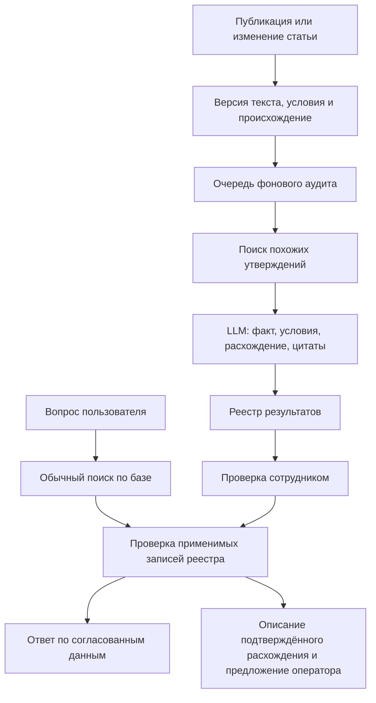

# Противоречия между статьями: разбор и план переноса

Дата исследования: 12 сентября 2026. На момент исследования код приложения не изменялся. Реализация первой итерации описана в [отчёте](source-conflicts-implementation.md), запуск — в [инструкции CLI](../SOURCE_CONFLICTS.md).

Рабочая трактовка запроса — находить разные, взаимоисключающие ответы на один вопрос в базе знаний. Отдельный поиск ответа внутри длинной статьи — соседняя задача, уже описанная в `retrieval-quality-plan.md`. Эти возможности дополняют друг друга, но требуют разных проверок качества.

## Что найдено

Удалённые ветки проверены через `git ls-remote` 12 сентября. Код прочитан из локальной копии исходного репозитория через `git show` по точным коммитам; рабочее дерево этой копии не использовалось как версия ветки и не изменялось.

| Репозиторий / ветка | Проверенный коммит | Назначение |
|---|---|---|
| `tender_hack_nijniy_2026`, `feat/rag-context-retrieval` | `0d29096dd06574ee16fa6b207ea5091fddda8d89` | Контекст диалога, исходный запрос и дополнительные поисковые формулировки |
| `tender_hack_nijniy_2026`, `feat/rag-retrieval-outcomes` | `b132ddc6793e11c592c71b969f36b1b2812b442e` | Явные исходы: есть подтверждение, нужно уточнение, подтверждения нет |
| `tender_hack_nijniy_2026`, `feat/rag-source-conflicts` | `c26d522f404fbd0bb69ac58340628903a72c2753` | Фоновый поиск противоречий, реестр, проверка сотрудником, защита чата |
| Наш `tender_nn_2026`, `codex/retrieval-quality` | `46e6e0d91e86c23fc572c55bf371812fe09d9b92` | Основа для адаптации |

По истории Git ветка конфликтов продолжает две предыдущие. Это не означает, что для переноса реестра нужно переносить весь их код.

Основной источник — [ветка конфликтов на проверенном коммите](https://github.com/Mojarung/tender_hack_nijniy_2026/tree/c26d522f404fbd0bb69ac58340628903a72c2753). Наличие этой реализации в текущем удалённом `main` и состояние развёрнутого приложения в рамках исследования не проверялись.

## Как работает найденная реализация

Пример: статья A разрешает загрузку файла до 10 МБ, статья B — до 20 МБ. Если речь об одной форме загрузки, одной роли и одном периоде действия, инструкции расходятся. Разница только в номере рисунка или явно разные формы загрузки такого вывода не дают.

1. Активная `KBArticle` превращается в `KBClaim`: снимок текста `question + answer` с хешем и ссылкой на статью.
2. `SourceConflictCandidateFinder` ищет похожие статьи через эмбеддинги и векторное хранилище. Полного сравнения всех пар нет.
3. `SourceConflictAuditor` отправляет выбранные пары в LLM в фоновом воркере, с ограничениями числа пар, параллелизма и времени.
4. Модель отдельно определяет: один ли факт обсуждается, пересекаются ли условия, совместимы ли утверждения и существенно ли различие. Код вычисляет итог `conflict`, `compatible` или `uncertain`.
5. Пары сохраняются в `KBConflict`. Повторные пары текущей версии пропускаются; изменения статьи делают связанные результаты устаревшими.
6. Отдельная фоновая группировка объединяет пары одного факта в кейсы с несколькими источниками. Операторский экран `/conflicts` показывает статьи и позволяет выбрать источник, указать разные условия, отклонить находку или вернуть её на проверку.
7. После получения ответа агента чат проверяет реестр по процитированным статьям. Открытый конфликт заменяет уверенный ответ описанием расхождения; принятое сотрудником решение может подставить выбранную версию.

Основные файлы исходной ветки:

- [Модели claims и конфликтов](https://github.com/Mojarung/tender_hack_nijniy_2026/blob/c26d522f404fbd0bb69ac58340628903a72c2753/backend/app/models_conflicts.py).
- [Поиск пар-кандидатов](https://github.com/Mojarung/tender_hack_nijniy_2026/blob/c26d522f404fbd0bb69ac58340628903a72c2753/backend/app/services/source_conflict_candidates.py).
- [Контракт LLM и таблица решений](https://github.com/Mojarung/tender_hack_nijniy_2026/blob/c26d522f404fbd0bb69ac58340628903a72c2753/backend/app/services/source_conflict_detector.py).
- [Оркестрация аудита](https://github.com/Mojarung/tender_hack_nijniy_2026/blob/c26d522f404fbd0bb69ac58340628903a72c2753/backend/app/services/source_conflict_audit.py).
- [Реестр, устаревание, решения и группировка](https://github.com/Mojarung/tender_hack_nijniy_2026/blob/c26d522f404fbd0bb69ac58340628903a72c2753/backend/app/services/source_conflicts.py).
- [API проверки](https://github.com/Mojarung/tender_hack_nijniy_2026/blob/c26d522f404fbd0bb69ac58340628903a72c2753/backend/app/routers/source_conflicts.py) и [интерфейс](https://github.com/Mojarung/tender_hack_nijniy_2026/blob/c26d522f404fbd0bb69ac58340628903a72c2753/frontend/src/pages/ConflictsPage.tsx).

## Насколько решение проверено

Код, его подключения и тексты тестов просмотрены статически. Тесты, модель и приложение в этом исследовании не запускались.

В [отчёте раннего detector v7](https://github.com/Mojarung/tender_hack_nijniy_2026/blob/c26d522f404fbd0bb69ac58340628903a72c2753/backend/evals/reports/source_conflict_quality_v1_review.md) авторы приводят 13 совпадений из 15 размеченных пар и медиану LLM-вызова 18,8 секунды. Это небольшой диагностический набор, а не доказанная точность на нашей базе.

Более поздний [отчёт по detector v9](https://github.com/Mojarung/tender_hack_nijniy_2026/blob/c26d522f404fbd0bb69ac58340628903a72c2753/docs/RAG_SOURCE_CONFLICTS_PLAN.md#L202) описывает обработку 200 статей за примерно 24 минуты: 123 оценённые пары, из них 87 совместимых, 32 неопределённых и 4 конфликта. Ручной просмотр подтвердил два полезных расхождения; ещё два потребовали отклонения из-за исключения либо разных точек отсчёта.

Это результаты, записанные авторами ветки 30 августа — 1 сентября. Они здесь не воспроизводились. Практический вывод: механизм полезен как помощник проверки базы, а автоматическое влияние новых находок на ответы пользователю требует отдельной оценки.

## Что уже есть у нас

| Компонент | Наш код | Как использовать |
|---|---|---|
| Статьи, роль, статус, происхождение | `backend/app/models.py`, `schemas/kb.py` | Ссылки на действующие статьи и исходный документ |
| Гибридный поиск, эмбеддинги, векторное хранилище | `services/retrieval.py`, `adapters/embeddings.py`, `adapters/vectorstore.py` | Инфраструктура поиска похожих материалов |
| Индексация и снятие статей | `services/kb.py` | Связь фонового аудита с состоянием индекса |
| CRUD, массовые действия и импорт | `services/articles.py`, `ingest/pipeline.py` | Инвалидация результатов при изменении первичных данных |
| Фоновые задачи и настройки | `tasks/jobs.py`, `runtime.py`, `dynamic_settings.py` | Ограниченный аудит, переключатели и прогресс |
| Дословный ответ | `chat/steps.py::_maybe_verbatim` | Обязательная проверка конфликта до отправки текста |
| Ответ агента | `services/chat.py::_agent_answer` | Проверка итоговых источников до отправки текста |
| Повтор после отзыва | `chat/answer_recovery.py` | Не потерять проверку при повторной генерации |
| Копайлот сотрудника | `services/copilot.py`, `chat/copilot_flow.py` | Показывать расхождение рядом с черновиком |
| Админка и просмотр источников | `frontend/src/pages/admin/`, `components/SourceModal.tsx` | Очередь проверки и переход к оригиналу |

Реестра `KBClaim`/`KBConflict` и подключения `source_conflicts` в просмотренном коде нашего приложения нет. При этом поиск ответов, уточнение роли, дословная выдача и проверка отдельных фактов в сгенерированном ответе уже реализованы. Новый модуль должен проверять согласованность самой базы знаний.

## Что при переносе нужно изменить

**1. Передавать условия и происхождение явно.** В исходной ветке `_article_claim_text` собирает только вопрос и ответ. В нашей базе роль может находиться в `KBArticle.audience`, а документ и место в нём — в `origin`. Детектор не должен угадывать эти поля по тексту. `source="import"` также не обозначает конкретный документ.

**2. Учитывать тип записи.** У нас есть `answer`, `operator_case` и `reference`. История «на момент проверки документ подписан» не является универсальным правилом для сравнения с инструкцией. Первый аудит ограничить активными ответами; смешанные и неполные записи обозначать отдельно.

**3. Отбирать кандидатов специально для сравнения утверждений.** Наш основной вектор статьи строится из вопроса, ключевых слов и первых 400 символов ответа. Дополнительные точки отражают формулировки вопросов. Это не гарантирует обнаружение расхождения глубоко в инструкции. Кроме того, обычный `Retriever.search` сворачивает одинаковые вопросы через `newest_per_question`: такой путь может удалить вторую сторону будущего конфликта. Аудиту нужен собственный отбор без этой потери, с дедупликацией по статье/фрагменту.

**4. Сделать выборку реестра ограниченной на уровне SQL.** В проверенном `actionable_for_articles` исходной ветки запрос загружает все активные конфликтные пары, затем Python группирует их и фильтрует по запрошенным статьям. Это расходится с описанием одного адресного lookup в плане. Финальный `selected[:limit]` также может обрезать большой кейс. У нас сначала выбирать затронутые пары/кейсы по индексам, затем их участников; страницы ограничивать по кейсам. Малые опубликованные замеры задержки не доказывают масштабируемость полного сканирования.

**5. Решение относится к факту и условиям, а не ко всей статье.** Если два документа расходятся в лимите файла, это не повод заменять любой ответ из первого документа вторым. Проверять связь конфликтного фрагмента с текущим вопросом и реально используемым evidence. Дата изменения статьи и similarity не определяют, какое правило верно.

**6. Охватить все пути выдачи.** Копирование проверки только после LLM оставит обход через `_maybe_verbatim`. Проверка должна работать до отправки дословного ответа и перед отправкой окончательного ответа агента, включая повтор после отзыва. В копайлоте предупреждение должно быть видно до вставки черновика.

**7. Не оставлять решения на устаревшем третьем источнике.** В исходной групповой проверке источник C может стать авторитетным для ребра A–B. При этом `_mark_claim_ids_stale` проверяет только левый и правый endpoints, а chat lookup не проверяет активность третьего авторитетного claim. Из статического чтения следует риск сохранения решения A–B после изменения/архивации C. В нашей модели инвалидация должна охватывать всех участников и выбранный источник кейса. Отдельно проверить удаление и повторную публикацию.

**8. Не привязывать необработанные изменения к времени включения переключателя.** В исходном расписании используются `created_at` claim и время изменения флага аудита. Повторная активация старого claim или включение после паузы требуют отдельной проверки: старый `created_at` может оставить материал вне очереди. Хранить событие/ревизию, которую нужно обработать; историческую загрузку ограничивать отдельным курсором и бюджетом.

## Предлагаемая архитектура

LLM-аудит выполняется заранее. Проверка реестра в чате не вызывает новую модель и не строит эмбеддинги. Инфраструктура остаётся нашей: PostgreSQL/SQLite, текущий worker, Redis и векторное хранилище.

Первый режим — только сбор находок и проверка сотрудником. Предлагаемое отличие от исходной ветки: необработанная находка модели не объявляется пользователю установленным противоречием. Сотрудник может подтвердить само расхождение, ещё не выбрав действующее правило.

## Этапы реализации

### 1. Реестр и корректное устаревание

Добавить модели в `backend/app/models_conflicts.py`, сервис реестра и регистрацию в `db.py`/`runtime.py`. Сохранить наши типы времени `UTCDateTime` и подход к типизированным схемам.

Минимальный снимок утверждения: `article_id`, текст, `content_hash`, `audience`, тип записи, источник/локатор, доступная версия документа, статус. Хеш для повторного использования результата учитывает содержательные условия, а не только текст. Просмотры и оценки полезности не должны создавать новую версию утверждения.

У пары хранить канонические стороны, результат detector, факт, условия, точные подтверждающие выдержки, версию модели/промпта, состояние проверки и решение сотрудника. Результат модели и решение человека — разные данные. Предусмотреть подтверждённое, но ещё не разрешённое расхождение.

Инвалидацию связать с записью изменений статьи: create/update/publish/archive/purge, массовые действия и замена документа при импорте. Состояние старого решения не должно зависеть от того, успел ли отработать Qdrant или worker. Реестр перепроверяет актуальность снимков и при чтении.

Результат этапа: можно хранить и вручную разбирать результаты; чат продолжает работать как прежде. Одно и то же событие не создаёт дубли. Поздний результат модели по старой версии не становится действующим.

### 2. Ограниченный фоновый аудит

Адаптировать finder, detector и auditor отдельными сервисами. Использовать текущие адаптеры, не заменяя наш поиск реализацией из старой ветки.

Для первого прохода брать короткие статьи с понятным предметом. Длинные фрагменты с несколькими темами считать неполностью проверенными; следующий шаг — выделение нескольких утверждений с привязкой к исходным фрагментам. Не выдавать отсутствие найденных пар за доказательство непротиворечивости статьи.

Начать с объединения семантических кандидатов и кандидатов по конкретным терминам/объектам. Сравнить несколько значений числа соседей на размеченной выборке. `top_k=1` и порог `0.7` из чужого прогона не переносить как доказанно подходящие настройки. Если текущего представления ответа недостаточно, индексировать законченные фрагменты для аудита; единый формат фрагмента согласовать с работой по качеству retrieval.

Вход detector содержит оригинальные выдержки и известные условия. Ответ включает раздельные отношения факта/условий/утверждений/существенности; итог вычисляет код. Проверять, что цитаты действительно присутствуют в соответствующем снимке. Не считать пересказ модели оригинальной цитатой.

У задачи должны быть лимиты статей, пар, времени и затрат; сохранённый прогресс; повтор ошибок с задержкой; остановка на устойчивом `429`; защита от параллельных одинаковых запусков. Версия обработки включает способ отбора кандидатов и модель/промпт. В lite-режиме не запускать аудит из HTTP-обработчика через `await_inplace`.

Результат этапа: ограниченная партия создаёт очередь объяснимых находок и отчёт о покрытии/ошибках. Повтор без изменений не вызывает модель для уже оценённых пар. Расписание пока выключено.

### 3. Экран проверки и кейсы с несколькими источниками

Добавить страницу `/admin/source-conflicts`, типизированные схемы и API. Для первого запуска решения принимает администратор базы знаний; расширение прав на операторов можно включить отдельно. Не смешивать чтение очереди с правом менять действующее правило.

Карточка: проверяемый факт, условия, документ и место в нём, исходные выдержки рядом, объяснение расхождения, состояние проверки. Действия: подтвердить расхождение, выбрать действующий источник для этих условий, отметить разные условия, отклонить ошибку, вернуть на проверку. Причина и автор решения сохраняются в журнале аудита.

Начать с пар; затем объединять 2–N источников одного факта. Для полноценного группового режима материализовать идентификатор кейса и его участников с индексами, чтобы не собирать весь граф при каждом запросе. Решение и версия принадлежат кейсу. Группировка не должна объединять разные свойства документа или распространять выбор на другие условия. Большой кейс не обрезается обычным лимитом списка пар.

Использовать наши компоненты и генерацию API-типов. Режим просмотра конфликтов должен показывать точные доказательные выдержки: нынешняя подсветка `SourceModal` по пересечению слов не доказывает противоречие. Уверенность LLM не показывать как процент точности.

Результат этапа: сотрудник может проверить находку по оригиналам и оставить воспроизводимое решение; случаи из трёх источников не теряют участников и корректно устаревают.

### 4. Подключение к ответам

Добавить общий модуль политики использования источников, например `backend/app/chat/source_conflicts.py`.

Проверять выбранную статью непосредственно перед дословной выдачей; проверять фактические источники ответа агента до первого отправленного фрагмента. Можно переиспользовать уже полученную выборку реестра в пределах одного хода и допрашивать только новые источники. При неоднозначной роли сначала разрешать роль; близкие оценки двух статей сами по себе не означают конфликт.

Связь с вопросом должна опираться на используемый фрагмент и условия. Если доступна только большая статья целиком и применимость конкретного конфликта установить нельзя, такая находка остаётся подсказкой сотруднику до улучшения гранулярности evidence.

При подтверждённом и применимом открытом конфликте показывать конкретное расхождение, обе версии с источниками и предложение оператора. Пользователь не должен сначала получить уверенную цифру, а затем оговорку. Решение сотрудника использовать только в его области действия и пока действительны все связанные версии.

В API добавить отдельный `retrieval_outcome="source_conflict"` и структурированные сведения об источниках. Согласовать REST, WebSocket, историю, чат, виджет и расширение. Такой исход не засчитывать как успешный ответ и не складывать в «пробел базы»: данные есть, но противоречат друг другу. Старые сообщения без новых полей должны продолжать читаться.

Сохранить `answer_guard`: согласованность документов и обоснованность сгенерированного ответа — разные проверки. Для копайлота показывать предупреждение и версии до вставки черновика.

Флаги: отдельно аудит, диагностический lookup и видимое поведение. Все выключены по умолчанию. Ошибка lookup помечается как техническая недоступность проверки, а не как «конфликтов нет»; первоначальная политика — продолжить существующий ответ и зафиксировать сбой. При уже найденном применимом подтверждённом конфликте уверенный ответ не возвращать.

Результат этапа: подтверждённое расхождение учитывается во всех путях ответа; выключение видимого режима возвращает прежнее поведение без удаления реестра.

### 5. Проверка на нашей базе и постепенное включение

Подготовить небольшой диагностический набор, затем отдельную контрольную выборку, которую не использовать для настройки промпта и порогов. Разделять связанные статьи одного документа между наборами осмысленно, чтобы перефразировки одной пары не создавали иллюзию независимой проверки.

Сценарии: разные суммы/лимиты, разрешение против запрета, разные единицы, рабочие и календарные дни, разные точки отсчёта, роли, этапы, периоды, явные исключения, номера рисунков, недостающие условия, несколько тем в статье, одинаковые заголовки с разными ответами. Примеры для коммита — синтетические либо подготовленные без сырых диалогов и персональных данных.

Отдельно измерять:

- Полноту отбора кандидатов: попала ли известная конфликтная пара к detector вообще.
- Точность категории `conflict`, пропуски и долю `uncertain`; ручной просмотр всех найденных конфликтов и выборки остальных результатов.
- Долю реально проверенных статей/утверждений, необработанные материалы и ошибки.
- Время и стоимость фоновой обработки, отсутствие повторных платных вызовов без изменений.
- Корректность выбора источника в чате и дополнительную задержку lookup. Начальный ориентир для измерения — p95 до 50 мс на согласованном объёме реестра; это целевой бюджет, а не текущий результат.

Проверки реализации после отдельного разрешения на запуск: идемпотентность и гонки, изменение/архив/удаление/повторная публикация, замена документа, устаревание выбранного C в A–B–C, точность цитат, разграничение прав, неизменность поведения при выключенных флагах, дословный ответ, ответ агента, повтор после отзыва, история/виджет/расширение, отсутствие ошибочного учёта в аналитике.

Порядок включения: ручная ограниченная партия → разбор сотрудником → lookup только в диагностике → показ подтверждённых применимых кейсов → инкрементальная обработка новых изменений. Первичную обработку старой базы запускать отдельными партиями. Массовый аудит, расписание и развёртывание не являются действиями, выполненными этим исследованием.

## Рекомендованный первый объём работы

Первое изменение — модели, жизненный цикл реестра и ограниченный ручной запуск фонового аудита с выдачей находок сотруднику. Это позволяет проверить полезность на наших статьях до изменения поведения чата.

Переносить выборочно: контракт detector, принцип канонических пар, версии обработки, ограничения воркера и сценарии проверки. Переписать под наш проект: подключение к CRUD/импорту, отбор кандидатов, адресную SQL-выборку, работу с ролями и происхождением, групповые решения, типы API и пути выдачи ответа. Полный merge старой ветки слишком широко затрагивает разошедшиеся `chat.py`, схемы, индексацию и интерфейс.

Работу оформлять отдельно от текущих изменений `codex/retrieval-quality`. Существующий план качества поиска не заменять: сначала нужно находить правильные подтверждающие фрагменты, а реестр дополнительно проверяет, согласуются ли они между собой. Сам реестр не исправит пропуск определения глубоко в PDF.

Следующий конкретный шаг — согласовать этот объём как первую итерацию и реализовать этапы 1–2. Приложение, данные, CI и тестовые прогоны в текущем исследовании не изменялись и не запускались.
